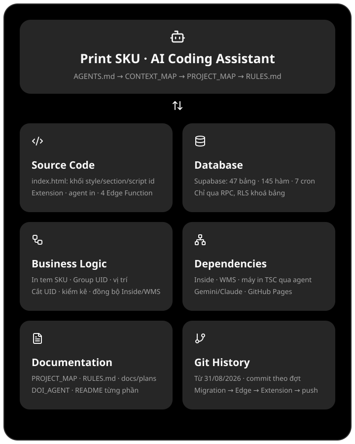
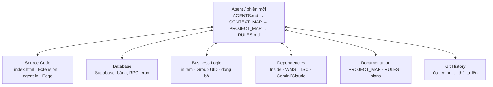

# BẢN ĐỒ NGỮ CẢNH Print_SKU (23/10/2026)

Trang mở đầu cho mọi agent / phiên mới: 6 nguồn ngữ cảnh, mỗi nguồn ghi **đọc ở đâu**, **hỏi thế nào**, **bẫy hay gặp**. Chi tiết từng module nằm ở `docs/PROJECT_MAP.md`; tệp này chỉ là mục lục để biết tìm gì ở đâu.



**Thứ tự đọc khi bắt đầu phiên:** `AGENTS.md` (luật làm việc) → tệp này → `docs/PROJECT_MAP.md` (module → id khối → Extension/Edge/SQL) → `RULES.md` (chỉ có trên máy: **đọc mục lục "QUYẾT ĐỊNH ĐANG HIỆU LỰC" ở đầu tệp** theo 12 chủ đề + trạng thái lên thật; nhật ký nguyên văn ở dưới, mục lục trỏ "dòng N") → `docs/plans/<ngày>-<tên>.md` của việc đang làm. Gói một tệp cho AI khác đọc: mục **Gói ngữ cảnh (repomix)** ở cuối.

**Dự án là gì (một câu):** công cụ kho xưởng may Hasaki — trang tĩnh in tem SKU / Group UID / vị trí, cắt và kiểm UID, kiểm kê, đối chiếu với Inside + WMS; dữ liệu ở Supabase, lệnh in đi qua hàng đợi tới agent trên máy trạm `may-kho-01`.



## 1. Source Code — mã nằm đâu
| Phần | Đường dẫn | Ghi chú |
|---|---|---|
| Web (một tệp, GitHub Pages) | `index.html` (~2,5 MB) | Mỗi module = `<style id>` + `<section id="…-screen">` + `<script id>` IIFE. Tìm bằng id / chuỗi neo, **không theo số dòng**. Có một dòng bundle React minified (IN TEM SKU) — chỉ sửa bằng neo ngắn. Danh sách khối: PROJECT_MAP mục 2. |
| Chrome Extension | `extension/inside-po-connector/` (phiên bản ở `manifest.json`) | Đọc Inside/WMS trong tab đã đăng nhập (token không rời tab) + đồng bộ tự động nền. PROJECT_MAP mục 3. |
| Edge Functions | `supabase/functions/{sku-sync,group-uid-sync,print-assistant,sku-vision}/index.ts` | `verify_jwt` false. `sku-sync`, `group-uid-sync`, `print-assistant` tự kiểm JWT Admin; `sku-vision` công khai (chỉ kiểm publishable key + trần lượt/ngày). Deploy bằng `scripts/deploy_<tên>.py`. |
| Agent in | `workstation-agent/` (phiên bản ở `VERSION`) | Node trên `may-kho-01`: claim `print_jobs` theo capability → vẽ tem → máy in TSC. Mẫu tem `src/templates/`. |
| Công cụ | `scripts/*.py` | `run_tests.py`, `commit_gate.py`, `apply_supabase_sql.py`, `codex_review.py`, `deploy_*.py`. |
| Test | `tests/*.cjs|*.mjs`, `workstation-agent/tests/` | `python scripts/run_tests.py` (máy chủ tĩnh cổng 8000), agent: `node --test`. |

**Tìm khối nhanh:** `python scripts/index_outline.py [chuỗi lọc] [--big KB]` in mục lục khối (loại, id, dòng đầu–cuối, KB) trong < 1 giây; mọi khối style/script đều có id. **Grep `index.html` luôn giới hạn độ dài dòng** (`rg -M 300 …` hoặc lọc theo khoảng dòng từ mục lục): khối `worker-bundle` (bundle React, 613 KB) và `group-banners` có dòng dài hàng trăm KB, trúng là tràn ngữ cảnh.

**Bẫy:** đừng Write đè cả `index.html` (hook chặn); sửa nhỏ nhất bằng neo. Nhiều phiên có thể cùng sửa `index.html` — commit chỉ phần của mình (blob từ HEAD + phần sửa).

## 2. Database — Supabase
- Project `SKU_Name` (id ở `scripts`/`.env`, không chép vào tài liệu). Khoảng 47 bảng, 145 hàm, 7 việc pg_cron (23/10/2026).
- **Mô hình quyền (gần như RPC-only):** bảng nội bộ bật RLS **không policy** (chỉ service_role) — web/Extension/agent gọi hàm `SECURITY DEFINER` `search_path = ''` tự kiểm quyền: Admin (`group_uid_admin_allowed()` / `user_roles`), khoá máy (`floor_access_check`, `print_device_by_token`), token agent (`print_agent_*`); hàm đọc cho anon chỉ ở các màn xem. **Ngoại lệ:** `SKU_Name` có policy SELECT SKU đang hoạt động (`sku_name_read_active`, `sku_inactive_v1`) — web và agent đọc thẳng qua PostgREST.
- **Migration = chuỗi tệp** `supabase/*.sql` (idempotent, `notify pgrst`); **bản mới nhất của một hàm nằm ở tệp mới nhất đụng nó** — chuỗi từng nhóm ở PROJECT_MAP mục 4.
- Hỏi DB: Supabase MCP **chỉ đọc** (SELECT trên catalog / đếm). Ghi, migration, deploy: người dùng chạy `python scripts/apply_supabase_sql.py <tệp>`.

**Bẫy:** default privileges của schema `public` vẫn cấp EXECUTE cho anon/authenticated — hàm mới phải `revoke` đích danh `anon, authenticated` (không chỉ `public`). `print_jobs` chỉ giữ 3–6 ngày (không dùng làm lịch sử).

## 3. Business Logic — quy trình
| Luồng | Đi qua | Đọc thêm |
|---|---|---|
| In tem (SKU, Group UID, vị trí, Phụ liệu có PO) | web `PrintSkuQueue.enqueue` → RPC `print_enqueue` (khoá máy, nonce chống trùng, chặn SKU ngừng, tên theo `SKU_Name`) → `print_jobs` → agent claim theo capability (`sku:v1/v2/v3`, `group_uid:v1`, `location:v1`) | PROJECT_MAP mục 4 "In", `workstation-agent/README.md` |
| Đồng bộ SKU (Inside) | Extension `GET_SKU_SYNC_DATA` → Edge `sku-sync` preview/apply (ngưỡng, held, lưu trữ SKU rời nhóm) | `docs/HUONG_TU_DONG_DONG_BO_SKU_SUPABASE.md` |
| Đồng bộ Group UID (WMS) | Extension `GET_GROUP_UID_PAGE` (đọc vào bộ nhớ, kiểm nhất quán) → Edge `group-uid-sync` prepare/ingest/preview/apply | `docs/THIET_KE_DONG_BO_GROUP_UID_VA_DASHBOARD.md` |
| Đồng bộ tự động | Extension nền `auto-sync.js`, alarms 30 phút trong giờ làm, lease 15 phút, 4 loại `group_uid`/`sku`/`cut_adj`/`storage_risk` | `docs/plans/2026-10-22-extension-0107-tu-dong-mo-rong.md` |
| Xưởng: cắt / lấy mẫu / cấp vải / xả vải / lựa UID blocked | RPC ghi qua `floor_access_check` (máy đã kích hoạt) | PROJECT_MAP mục 4 "Khoá máy" |
| Kiểm tra: kiểm kê, rủi ro lưu trữ, kiểm tra đầu vào, đối chiếu ADJ | bản chụp Supabase + đọc WMS qua Extension | PROJECT_MAP mục 2 |

**Bẫy:** quyết định nghiệp vụ đã chốt (vd. không nạp bù SKU ngừng, Combo vẫn hiện Inactive, mỗi lot cắt + QC ≥ 30 %) nằm trong `RULES.md` — grep trước khi đề xuất lại.

## 4. Dependencies — hệ thống bên ngoài
- **Inside** (PO, SKU) và **WMS** (Group UID, phiếu IT, Import/Export, history): chỉ đọc qua content script Extension trong tab người dùng đã đăng nhập; không gọi thẳng từ web hay Edge.
- **App xây dựng** (Kiểm soát công trình): `hcm-bridge.js`, Cloudflare Access + Bearer.
- **Máy in TSC** (USB, `may-kho-01`; `may-kho-02` đã tạo agent, chưa cài): chỉ qua agent.
- **AI:** Edge `print-assistant` (Claude nếu có khoá, không thì Gemini), `sku-vision` (Gemini). Khoá ở Supabase Secrets.
- **Hosting:** GitHub Pages — push `main` = web lên ngay.
- **Thư viện:** web không CDN/npm runtime (cấm thêm khi chưa được duyệt); agent: `sharp`, `qrcode-generator`; test: Playwright (ngoài repo, `PLAYWRIGHT_MODULE`), `axe-core`.

**Bẫy:** thứ tự lên luôn **migration → deploy Edge → Reload Extension (tải lại tab Inside/WMS) → cài agent nếu có → push web**.

## 5. Documentation — yêu cầu và quy tắc
| Tệp | Dùng để |
|---|---|
| `AGENTS.md` | Luật làm việc, kiểm chứng, bàn giao (áp cho mọi agent) |
| `docs/PROJECT_MAP.md` | Bản đồ chi tiết module ↔ khối ↔ Extension ↔ Edge ↔ SQL; cập nhật cùng commit khi đổi module |
| `RULES.md` (chỉ trên máy, gitignored) | Đầu tệp: mục lục quyết định đang hiệu lực (12 chủ đề, "Đã bỏ", "Làm sau", trạng thái lên thật); dưới: nhật ký theo thời gian. Quyết định mới ghi vào CẢ hai. Ràng buộc mọi agent |
| `docs/DOI_AGENT.md`, `.claude/agents/`, `.claude/skills/` | Đội agent (lead, trinh-sat, thuc-thi-logic, kiem-thu, co-van/Fable), quy trình review Codex + Claude |
| `docs/plans/` | Kế hoạch việc nhiều bước / có migration (mẫu `docs/plans/README.md`) |
| `docs/THIET_KE_*.md`, `docs/*-design/` | Chuẩn giao diện, icon, tem |
| `README.md`, `workstation-agent/README.md`, README Extension | Hướng dẫn vận hành, cài đặt, lịch sử phiên bản |
| Bộ nhớ Claude (`~/.claude/projects/<repo>/memory/`) | Ghi nhớ của lead theo phiên; không phải nguồn sự thật thay RULES.md |

Quy ước luôn đúng: trả lời tiếng Việt có dấu; UI = icon Lucide + nhãn ngắn, không câu hướng dẫn kiểu AI; Admin chỉ xét desktop; dữ liệu test giả (`9000000xx`, `1028260000000xxx`); commit/push chỉ khi người dùng nói.

## 6. Git History — lịch sử và thay đổi
- Repo `MCuongLe/Print_SKU` (public), nhánh `main`, bắt đầu 31/08/2026. Commit theo **đợt**, thông điệp tiếng Việt không dấu tóm tắt việc + phiên bản (vd. `Extension 0.10.7: …`, `Tem SKU mot mau v3 (agent 0.10.2) …`).
- Xem nhanh: `git log --oneline -20`; ai đổi khối nào: `git log -S "<id khối>" --oneline -- index.html`; lịch sử hàm SQL: `git log --oneline -- supabase/<tệp>.sql`.
- Hook: `git commit` tự chạy `scripts/commit_gate.py` (bí mật, dữ liệu thật, mojibake, CRLF, phiên bản Extension). Kỹ năng `/commit-push` chỉ người dùng gọi.
- Mốc phiên bản hiện hành: `extension/inside-po-connector/manifest.json`, `workstation-agent/VERSION`; trạng thái lên thật của từng đợt ghi trong `RULES.md`.

**Bẫy:** push `main` khi web cần hàm/Edge mới mà chưa chạy migration → web hỏng ngay; commit trước, chờ migration/deploy rồi mới push.

## Gói ngữ cảnh (repomix)
`repomix.config.json` ở gốc repo gói **phần lõi** thành một tệp XML (~118.000 token, 23/10/2026) cho AI khác đọc: tài liệu `docs/*.md`, Extension, Edge, agent in, script, hồ sơ agent/skill, 40 commit gần nhất. Mã JS/TS/Python được **nén** (giữ chữ ký hàm, cấu trúc, bỏ thân) — cần logic chi tiết thì đọc tệp thật trong repo. Không gói: `index.html` (2,5 MB — dùng PROJECT_MAP mục 2 + `scripts/index_outline.py`), migration SQL, test, ảnh, nội dung `docs/plans/` (chỉ tên tệp + `docs/plans/README.md`), `README.md` gốc và `workstation-agent/RULES.md` (dài, đọc riêng khi cần). Hồ sơ agent và vài tài liệu có đường dẫn máy người dùng (`C:/Users/…`) — repo đã public nên không phải bí mật, nhưng xem trước khi gửi gói ra ngoài. Có kiểm bí mật (secretlint) trước khi ghi. Đầu tệp gói có hướng dẫn đọc (`docs/repomix-instruction.md`).

```bash
npx repomix@1.18.1
```

Kết quả: `outputs/repomix/print-sku-context.xml` (thư mục `outputs/` không vào git — đừng chia sẻ ra ngoài nếu chưa xem). Không có gói riêng cho migration: thêm `--include` chỉ CỘNG vào danh sách của tệp cấu hình (thử 23/10: lõi + SQL = ~306.000 token, quá lớn). Hỏi về DB thì đọc tệp migration mới nhất theo PROJECT_MAP mục 4 hoặc hỏi Supabase (chỉ đọc).

`RULES.md` và `.env` không vào gói (gitignored) — agent trên máy đọc `RULES.md` trực tiếp.
